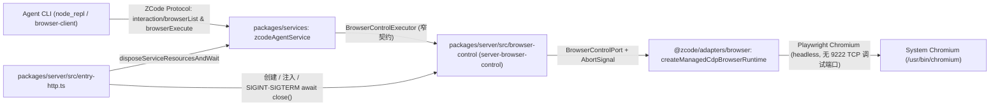

# 独立 HTTP Web Browser Use（`agent.browsers.*`）规格

## 1. 背景与定位

在独立 HTTP Web 模式（`packages/server/src/entry-http.ts`）中，Agent 侧通过 `node_repl` 注入的 `agent.browsers.list()` 调用协议方法 `interaction/browserList`，此前由于 `entry-http.ts` 与 `createServerHostServices` 未接入 `browserControlExecutor`，`zcodeAgentService` 始终返回 `{ browsers: [] }`，导致 `agent.browsers.list()` 为空。

独立 HTTP Web 复用官方受管无头 Chromium。浏览器能力分为三条链路：

1. **Desktop 内嵌浏览器（`type: "iab"`）**：仅存在于 Electron Desktop（`WebContentsView` + Main CDP），支持界面可见性、Chrome 导入与用户标签接管；独立 HTTP 服务端不引入 Electron。
2. **外部 `@playwright/mcp` MCP Server**：容器内独立预装的 MCP 工具集（`/opt/browser-mcp`），走 MCP tool 通道，不服务 `agent.browsers.*` JS 运行时接口。
3. **独立 HTTP 受管 CDP 运行时（`type: "cdp"`）**：复用官方 `@zcode/adapters/browser` 的 `createManagedCdpBrowserRuntime`，由 `@zcode/server` 受管模块 `server-browser-control` 持有并注入 `createServerHostServices`，为 `agent.browsers.*` 提供真实 headless Chromium / Playwright 执行后端。

## 2. 所有者与架构边界

- **单所有者原则**：
  - `ManagedCdpBrowserRuntime`（由 `packages/server/src/browser-control` 包装管理，生命周期归 `entry-http.ts`）是独立 HTTP 进程内 headless Chromium 与每会话 `BrowserContext` 的唯一所有者。
  - `packages/services` 仅通过 `BrowserControlExecutor`（即 `BrowserAmbientContextExecutor` 别名）接收并转发 `list` / `execute`，不依赖 `@zcode/adapters` 或 CLI 具体实现。
  - `packages/server` 仅通过 `@zcode/adapters/browser` 公开入口构建 runtime，不修改官方 `@zcode/adapters/browser` 源码，不造平行浏览器框架。
- **启动方式**：不修改 `Dockerfile` 中 `ZCODE_AGENT_SERVER_ARGS_JSON`（保持 `["/app/zcode/agent/zcode.cjs","app-server","--stdio"]`）；`agent.browsers.*` 统一经由服务端的 `interaction/browserList` 与 `interaction/browserExecute` 闭环执行。

## 3. 契约与生命周期规则

### 3.1 启用门禁

- 仅独立 HTTP 入口（`packages/server/src/entry-http.ts`）装配 `server-browser-control`；`packages/zcode-server-cli`（source server / SSH / WSL / Docker 远端核心）、stdio server 与 Desktop Host 行为不变。
- `collectBrowserAmbientContext` 会在每次 prompt 发送前调用 `executor.list(...)`，而受管 runtime 的 `list()` 会按需启动 Chromium（不开放 `--remote-debugging-port=9222` 等 TCP 调试端口，仅使用 Playwright 默认管道）。因此默认仅在独立 Web 兼容模式开启（`ZCODE_STANDALONE_WEB_LOCAL_HOST_ALIAS === "1"`）或显式设置 `ZCODE_STANDALONE_BROWSER_USE=1` 时启用；设置 `ZCODE_STANDALONE_BROWSER_USE=0` 时显式禁用。

### 3.2 命令与会话隔离规则

1. **Discovery（`list`）**：
   - 调用 `browserControlPort.list({ sessionId, turnId, signal })`，不使用假 descriptor 占位；若无可用 Playwright/Chromium，显式抛出/传播错误，不返回虚假成功。
   - 返回列表经 `@zcode/shared` 的 `browserBackendDescriptorSchema` 校验。
2. **Scoped / Cached 门禁**：
   - `sessionContext === "cached"` 时拒绝创建新浏览器上下文或执行页面命令，显式返回 `ok: false`（`backend_unavailable`）。
   - 受管 CDP descriptor 不声明 `metadata.controlScopes === "1"`，因此 `openScope` / `releaseScope` 请求在桥层显式拒绝（`ok: false`、`backend_unavailable`，`openScope` 附带 `scope: { id: controlScopeId, state: "rejected" }`）。
3. **伪命令转译与取消**：
   - `turnEnded` -> 调用 `port.turnEnded({ sessionId: leaseId, turnId })`（不再透传进 `port.execute` 返回 `capability_unsupported`）。
   - `closeSession` 中止当前浏览器租约下的请求并释放其上下文。下一次 discovery 可为同一历史会话建立新租约，旧租约的命令和清理请求不能操作新租约。
   - `cancelRequest` -> 在桥内查找目标 `command.requestId` 对应的外部 `AbortController` 并触发 `abort()`，返回 `{ ok: true, value: { cancelled }, elapsedMs }`；同时尊重同 `sessionKey` 作用域校验。
4. **会话隔离与重新接入**：
   - 复合键：`sessionKey = JSON.stringify([workspaceKey, remoteSessionId ?? null, clientMode, sessionId])`，隔离工作区、远端会话和客户端模式。
   - Discovery 只有在真实后端可用后才返回描述符，并为当前会话建立租约。桥层将租约 ID 映射到真实 backend ID 和 generation，执行结果也返回同一租约身份。
   - 关闭只释放对应租约；同一历史会话再次 discovery 后获得新租约，旧 ID 不可执行或关闭新资源。无需依赖官方 adapter 的 generation 在正常重启后递增。
5. **结果校验**：
   - `execute()` 返回值经 `@zcode/shared` 的 `browserCommandResultSchema` 校验，避免 `any` 强转掩盖协议字段漂移。

### 3.3 Playwright 加载、Chromium 解析与进程回收

1. **Playwright 解析**：
   - 发行包布局下，`packages/server`（位于 `<root>/server/entry-http.js`）通过相对固定布局 `<root>/agent/zcode.cjs` 使用 `createRequire` 加载已随包 stage 的 `<root>/agent/node_modules/playwright-core`。
   - 本地源码开发模式下从当前包声明依赖 `playwright-core` 加载。
   - 不扫描用户目录或全局任意路径。
2. **Chromium 解析与沙箱**：
   - `server-browser-control`（由 `entry-http.ts` 调用）显式读取 `CHROME_EXECUTABLE_PATH` 环境变量并作为 `executablePath` 传入 `createManagedCdpBrowserRuntime`（官方 `resolveInstalledBrowserExecutable` 本身不读取 `CHROME_EXECUTABLE_PATH`）；未设置时复用 `resolveInstalledBrowserExecutable` 探测 Playwright / 系统常见路径（如 `/usr/bin/chromium`），不在运行时下载浏览器；保持官方 adapter 的启动参数策略。
3. **优雅退出与启动失败清理**：
   - `entry-http.ts` 启动阶段或服务初始化失败时确保回收已创建的 `browserControl`。
   - 监听 `SIGINT` / `SIGTERM`，先关闭 HTTP server 并等待 `disposeServiceResourcesAndWait(services)`，再 `await browserControl.close()` 尝试释放 Chromium 实例后退出。注：官方 `ManagedCdpBrowserRuntime.close()` 内部对 Playwright `browser.close()` 使用有界超时等待（默认 1,500ms），极端挂起场景下可能存在 late-close 超时限制。

## 4. 验收场景

1. **真实 Chromium 与 Services 链路闭环**（无模型调用）：
   - 通过 `createServerHostServices({ browserControlExecutor })` 装配真实 `ServiceCollection`，经 `IZCodeAgentService` 真实处理的 `interaction/browserList` 与 `interaction/browserExecute` 通道验证 `agent.browsers.list()` 返回 `type: "cdp"`。
   - 对本地 HTTP fixture 执行 `newTab` -> `navigate` -> `evaluate` -> `screenshot`，断言真实页面标题/DOM 结果与非空 PNG 字节。
2. **隔离、生命周期与守卫**：
   - 不同 `workspaceKey` / `remoteSessionId` / `clientMode` / `sessionId` 相互隔离，各自 tab 与 DOM 状态互不串线。
   - `sessionContext: "cached"` 拒绝新建 context/执行。
   - `openScope` / `releaseScope` 显式拒绝。
   - `cancelRequest` 中止在途请求并返回取消态。
   - `turnEnded` 正常收尾当轮请求。
   - `closeSession` 后旧租约请求被拒绝；同一历史会话再次 discovery 可正常使用，旧租约的重复关闭不影响新租约。
   - `close()` 可关闭本轮已启动的 Chromium 实例并拒绝后续请求（受官方 adapter 有界关闭等待限制，不宣称极端挂起下强制 kill 全部衍生进程）。
3. **双模式加载验证**：
   - 源码目录模式（declared dependency）与模拟/真实统一发行包布局（`<root>/server` -> `<root>/agent/zcode.cjs` -> `<root>/agent/node_modules/playwright-core`）均能成功加载并驱动真实 Chromium。

## 5. 验证状态

- 本地真实 Chromium 与脚本化 app-server 回归 15 项通过，涵盖服务协议反向请求、页面读写与截图、隔离、取消、关闭和同一历史会话重新接入。
- 发行布局加载器已通过；验证使用临时服务模块与现有发行包中的 Playwright，不代表完整 HTTP 发布镜像已经构建验证。
- 架构检查与浏览器桥定向类型检查通过。完整类型检查在 session-control 阶段因本地缺少 vitest 和 Node 类型依赖中止，完整构建交现有 Actions。
- 本地回归通过，待 GitHub Actions CI 构建校验与容器部署验证；当前线上运行服务尚未包含本次适配。
