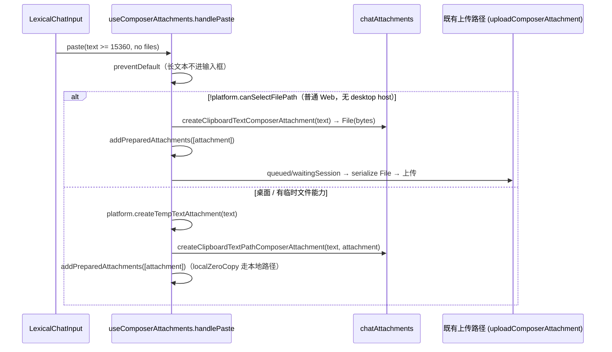

# 独立 Web 输入与设置收口：长文本粘贴附件与内置子代理模型选择器手机尺寸

固定上游 3c5b227649371507ddc4eb46ac5133afe6db1cab（3.16.2）。本 spec 覆盖两个独立的小范围收口：

1. **Composer 长文本粘贴**：普通 Web（无 desktop host）粘贴 ≥15360 字符文本时，当前先 `preventDefault` 再调用 `platform.createTempTextAttachment`，因该平台方法缺失而失败，长文本既没进输入框也没变成附件。
2. **设置页内置子代理行**：内置子代理行内 model / effort 覆盖控件的 `ModelConfigSelect` 未传 `isMobileViewport`，手机（≤767px）下拉菜单项仍按桌面 32px 渲染。

连接生命周期见 `deploy/specs/standalone-web-recovery.md`，设置页服务边界与单栏布局见 `deploy/specs/standalone-web-settings.md`。本 spec 不改上传协议、不改模型/推理强度/Provider 存储、不改全局样式。

## 状态所有者与接口

| 事实 | 唯一所有者 | 读取/写入接口 |
| --- | --- | --- |
| 长文本粘贴是否转附件 | `shouldCreateClipboardTextAttachment`（阈值 `LONG_PASTE_TEXT_ATTACHMENT_CHAR_THRESHOLD = 15 * 1024`） | `packages/ui/src/lib/chatAttachments.ts` |
| Web 长文本附件的内存载体 | 剪贴板文本 `File`（bytes） | `createClipboardTextComposerAttachment(text)` |
| 桌面长文本附件的零复制载体 | 主进程临时文件 | `platform.createTempTextAttachment` + `createClipboardTextPathComposerAttachment` |
| 附件入列与上传调度 | `useComposerAttachments` 的 `addPreparedAttachments` → 既有 `uploadComposerAttachment` | `packages/ui/src/v4/composer/useComposerAttachments.ts` |
| 菜单手机尺寸开关 | `ModelConfigSelect` 的 `isMobileViewport` prop → `data-mobile-model-picker` | `packages/ui/src/ModelConfigSelect.tsx` + `styles.css` |
| 手机视口判定 | `useIsMobileCompactViewport()`（`max-width: 767px`） | `packages/ui/src/lib/mobileTextInput.ts` |

### 长文本粘贴：按平台能力分流，不新增上传协议

- 分流条件复用既有 `platform.canSelectFilePath`：与 `openAttachmentPicker` 判定 Web/桌面的口径一致，不新增能力探测字段。
- Web 分支复用 `createClipboardTextComposerAttachment`（已有，产出带 `sourceKind: "clipboard-text"` / `charCount` / `lineCount` 的内存 `File` 附件）与 `addPreparedAttachments`；不把长文本塞进 Composer 正文，不新增上传协议，上传继续走既有 bytes 序列化路径。
- 桌面分支保持原临时文件路径与 `createClipboardTextPathComposerAttachment`，`localZeroCopy` 行为不变。
- 保留 `LONG_PASTE_TEXT_ATTACHMENT_CHAR_THRESHOLD`（15 * 1024）长文本限制与 `preventDefault` 时序。

### 内置子代理模型选择器：手机沿用既有菜单视口样式

- `SubagentModelOverrideControl` 调用已有 `useIsMobileCompactViewport()`，把 `isMobileViewport` 透传给其 `ModelConfigSelect`。
- 手机下复用 `ModelConfigSelect` 既有手机分支：触发器 `min-h-11`、菜单 `data-mobile-model-picker`（`styles.css` 中 `[data-mobile-model-picker]` 的 44px 触控高度与宽度收敛）。桌面传 `false`，渲染不变。
- 只改这一个内置/插件行内覆盖控件；add/edit 表单内的 `ModelConfigSelect`、模型候选、推理强度、Provider 存储、全局样式均不动。

## 验收场景

1. 普通 Web（`canSelectFilePath === false`）粘贴 ≥15360 字符纯文本：`preventDefault` 被调用，输入框不插入长文本；新增一个 `sourceKind: "clipboard-text"`、`mimeType: "text/plain"` 的内存 `File` 附件，走既有上传路径；不再调用 `platform.createTempTextAttachment`。
2. 桌面（`canSelectFilePath === true`）同样粘贴：仍调用 `platform.createTempTextAttachment`，附件保留临时文件路径与 `sourceKind: "clipboard-text"`，行为与修复前一致。
3. 短文本（< 15360 字符）粘贴：不 `preventDefault`，直接进入输入框（沿用既有行为）。
4. 手机（≤767px）设置页内置子代理行：`ModelConfigSelect` 收到 `isMobileViewport === true`，菜单项 44px 触控高度；桌面渲染与既有断言不变。

## 独立云端项目目录浏览起点

ProjectEditor 沿用既有 isStandaloneWeb 判定，只给当前 OCI 独立 Web 的 DirectoryBrowser 传 initialPath=/workspace。选择器继续拥有当前路径和请求序号，目录读取沿用 projectService；不更改 HOME、服务默认 home、文件权限或自动项目分配规则。真实远端设备不传此路径，桌面仍用系统目录选择器。本项只指定当前部署的浏览起点，不增加新的配置或路径限制。

验收：中文深浅主题，390px 手机与 1280px 宽屏 Web，新建项目 → 浏览目录初始为 /workspace 且目录读取成功；可以手动前往已存在的 /home/agent；取消浏览和关闭表单不创建项目。保留原先输入/技能/插件/模型菜单回归检查。
