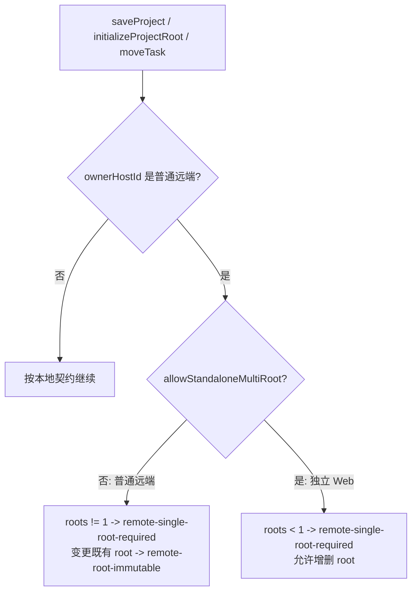
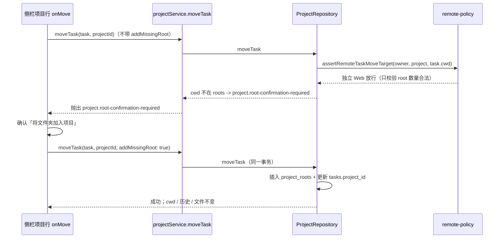

# 独立 Web 多 root 项目与任务移动

- 记录日期：2026-11-12
- 关联规格：[独立 Web 任务管理与非项目工作模式](./standalone-web-task-and-project-compat.md)

独立云端 Web 此前只支持单 root 项目：非项目会话与 0 目录新建项目依赖 `allowStandaloneCloudWorkspaces`，但项目 root 的数量与内容仍套用普通远端限制（`project.remote-single-root-required` / `project.remote-root-immutable`）。本轮补齐用户授权的项目能力：

- 独立 Web 项目可以拥有多个源文件夹（root）：可在网页内新增 / 移除 root、设置主要 root；
- 侧栏把已有任务拖入项目时，如果任务的 cwd 不是该项目 root，先询问用户，再以 `addMissingRoot: true` 复用 `IProjectService.moveTask` 把该 cwd 登记为该项目的 root；任务移动只改项目归属，不改 cwd、不搬文件、不改历史。

普通远端（真实 Source Server、桌面 `/remote` 远控、桌面 MessagePort）契约不变：仍单 root、root 不可变，跨 Host 仍拒绝。

## 独立 standalone scope 与普通 remote 的界限

能力开关是**显式**的，来自 standalone 装配点（`node.ts`）：`ZCODE_STANDALONE_WEB_LOCAL_HOST_ALIAS === "1"` 时同时开启 `allowStandaloneCloudWorkspaces`（非项目会话 + 0 目录自动 root）与 `allowStandaloneMultiRoot`（多 root 与移动增补 root）。两个能力是独立字段，未开启装配一律 fail closed。

| 维度               | 普通远端（真实 Source / 桌面远控） | 独立云端 Web                    |
| ------------------ | ---------------------------------- | ------------------------------- |
| 开启条件           | 默认                               | 仅 standalone 装配显式开启      |
| 项目 root 数量     | 必须 1                             | ≥ 1，可增删                     |
| root 内容可变      | 否（`remote-root-immutable`）      | 是（至少保留 1 个）             |
| 无项目会话         | 拒绝（`remote-project-required`）  | 允许，cwd 必须在工作区根内      |
| 任务 cwd 不在 root | 拒绝（`cwd-not-in-roots`）         | 允许，先确认再 `addMissingRoot` |
| 任务 cwd 增补      | 不允许                             | 允许（`project_roots` 增行）    |
| 跨 Host 移动       | 拒绝                               | 拒绝（不变）                    |

UI 侧的多 root 判定沿用独立 Web 的既有信号：没有本机目录选择器且项目 Host 被 standalone 别名映射为 `local`。别名本身由同一个环境变量开启，因此 UI 开关与后端策略始终同源。

## 状态所有者

| 事实                         | 唯一所有者               | 写入接口                              |
| ---------------------------- | ------------------------ | ------------------------------------- |
| 项目 root 集合与主要 root    | 所属 Host 的 project 库  | `projectService.saveProject`          |
| 任务项目归属 `project_id`    | 所属 Host 的 tasks-index | `projectService.moveTask`             |
| 任务 cwd `root_path`         | 移动不改写               | `addMissingRoot` 只写 `project_roots` |
| 独立策略（非项目 / 多 root） | 装配层 `node.ts`         | 组合期注入，不落库                    |

不新增数据库表、RPC 模型或第二处状态。

## 事件顺序

### root 数量与变更校验

### 移动任务（缺 root）

## 关键修复依据

- `moveTask` 原先对任何远端 owner 先跑 `assertRemoteTaskDirectories`；任务 cwd 不在唯一 root 时直接抛 `project.cwd-not-in-roots`，于是 UI 期待的 `project.root-confirmation-required` 分支永远到不了，用户拿到的是一个无法通过「确认」修复的错误码。桌面 ownerHostId 为 `local`，本来就跳过远端断言，所以只有独立 Web 暴露该问题。修复：把移动目标的校验拆成 `assertRemoteTaskMoveTarget`，独立 Web 只校验 root 数量合法性，缺 root 的裁决交回仓库自身的 `root-confirmation-required` + `addMissingRoot`，与桌面一致。
- 普通远端保持 fail closed：不在独立装配内的 owner 仍单 root、root 不可变、任务 cwd 必须落在唯一 root。
- 移动只改归属：`moveTask` 只更新 `tasks.project_id`（及 `handoff_pending` 标记），不写 `root_path`、不搬文件、不物化目录；增补 root 只往 `project_roots` 追加一行，且追加的路径取自任务行已持久化的 cwd（服务端事实），不是请求参数——请求里的 `workspacePath` 只用于定位任务行。因此多 root 不会演变成「客户端可任意指定宿主路径成为 root」，无需额外加工作区根限制（那会破坏 cwd 在工作区外合法 root 上的任务移动）。

## 验收

1. 独立 Web（`allowStandaloneCloudWorkspaces` + `allowStandaloneMultiRoot`）：`saveProject` 传 2 个已存在目录成功，项目 roots 为 2；移除其中一个 root 仍 ≥1 时成功。
2. 普通远端（只开 `allowStandaloneCloudWorkspaces`，或都不开）：`saveProject` 传 2 个目录抛 `project.remote-single-root-required`；改动既有 root 抛 `project.remote-root-immutable`。
3. 独立 Web `moveTask` 不带 `addMissingRoot`、任务 cwd 不在项目 roots：抛 `project.root-confirmation-required`（不再抛 `project.cwd-not-in-roots`）。
4. 独立 Web `moveTask` 带 `addMissingRoot: true`：项目 roots 增加该 cwd，任务 `project_id` 变为目标项目，任务 `root_path` 与文件不变。
5. 普通远端 `moveTask` 任务 cwd 不在唯一 root：仍是 `project.cwd-not-in-roots`，且 `addMissingRoot: true` 也不能把项目变成 2 root。
6. 跨 Host 移动（任务 Host 与项目 Host 不同）仍抛 `project.cross-host-move`。
7. 独立 Web 不会产生 0 root 项目：新建时未选目录自动分配唯一 root；既有项目提交空 root 集合时沿用原 root。编辑器对独立 Web 的最后一个 root 不提供移除入口，避免「移除后保存没有任何变化」。
8. UI：独立 Web 项目编辑弹层允许新增 / 移除多个源文件夹、设置主要 root；真实远端仍只有 1 个源文件夹且既有 root 不可移除。真机需人工复核（见验收脚本头部说明）。

可重复验收脚本见
`packages/web/test/e2e/manual-review/pending/standalone-multi-root-projects.mjs`（真实 SQLite + 真实
`ProjectRepository` / `createProjectService`，逐条覆盖 1–7）。
