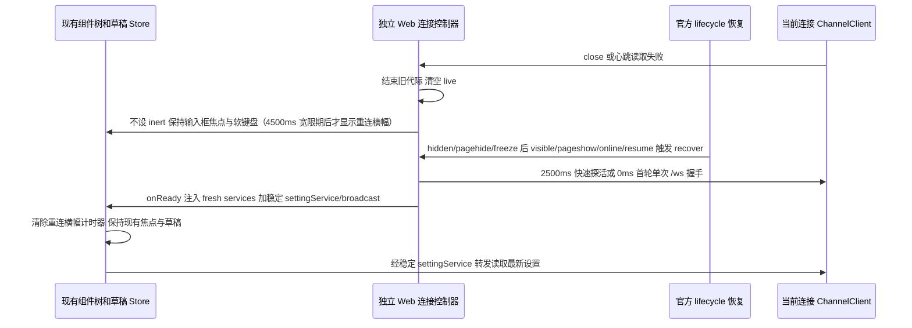

> 本规格描述已直接集成到当前源码的独立 Web 行为。下文的基础版本和补丁顺序仅是历史背景；构建使用本仓库当前源码，不再应用外部覆盖补丁。

# 独立 Web 重连连续性（防闪屏、提示宽限期与无锁页焦点保持）

固定上游 3c5b227649371507ddc4eb46ac5133afe6db1cab。只调整普通 `/ws` 独立 Web 的首连与重连体验；桌面 MessagePort 与 `/remote` relay 的所有权、恢复语义不变。连接生命周期见 [独立 Web 连接恢复](standalone-web-recovery.md)。

## 背景与根因

`connectViaWebSocket` 每次连接都构造新的 `RemoteServiceAccess`，其 `settingService` 实例随之更换。`useSettings` 的默认 `cacheKey` 按 `settingService` 实例身份（`WeakMap`）分键，新实例命中初始 `{ settings: null }` 快照，使 `OccupationOnboarding` 在 `!settings` 时整块卸载 workspace 内容（编辑器与草稿），表现为重连时“闪一下刷新”。

此外，若在断线期间给页面祖先元素设置 `inert` 会强制 blur 当前编辑器并收起移动端软键盘；首连或切后台瞬时重连若立即渲染顶部状态横幅，也会造成首屏跳动和视觉打断。

## 所有者与事件顺序

## 规则

- 连接控制器只拥有连接代际、心跳和重试，不保存任务事实，不重放任何业务写请求。
- **settingService 稳定转发**：`onReady` 只稳定 `settingService` 与 `broadcastService` 两个成员，其余 services 每次保持 fresh 对象。转发对象身份在同一 controller/root host 内不变，每次调用路由到当前 `live.settingService`；未连接时明确拒绝 `ConnectionClosed`，不排队、不缓存、不重放写请求。官方 `useSettings` 缓存继续按同一 `cacheKey` 唯一拥有设置快照，不在转发对象内保存设置。
- 保留 fresh `RootServices` 对象，使 `Root` 的 `[services]` effect 重新执行 `refreshAppSettings` 读取最新设置（`packages/ui/src/Root.tsx:538-566`）。
- **跨 Host 隔离**：每个独立 Web controller 拥有自己的转发对象，不修改全局 `cacheKey`；远端 workspace 的 `settingService` 继续使用各自身份，不跨 Host 串味。
- **lifecycle 复用与切后台快速探活**：复用官方 `createWebRemoteControlLifecycleRecovery`，只有真正经历 `hidden`/`pagehide`/`freeze` 暂停后，恢复事件（`visible`/`pageshow`/`online`/`resume`）才触发 `recover`；`onSuspend` 不主动关闭健康 WebSocket、不清空业务状态。`recover` 将连续失败计数清零：若当前连接仍在，发起 `2500ms`（`STANDALONE_RECOVER_PULSE_TIMEOUT_MS`，空闲周期心跳仍为 `25s` 间隔、`10s` 超时）短超时 `system.info` 探活；探活失败或连接已断开时，第一次重连以 `0ms` 延迟立即发起单次 `/ws` 握手（连续失败再按 `1s -> 2s -> 4s -> 8s` 退避）。并发恢复由当前连接代际和探活截止时间去重。若空闲心跳已经发出，切回前台时复用该请求，并将等待时间缩短至最多 `2500ms`。
- **首屏零横幅直出与重连提示宽限期**：
  - 首屏 `resolveWebBootstrap` 已通过 `/api/server-info`（`redirect: "manual"`）确认登录态有效（`initialAccessState === "ok"`）时，首连跳过重复 `/api/server-info` 与首包 `system.info` 探活，直接单次 `/ws` 握手挂载 `<Root>`。
  - 首连提示宽限期为 `3000ms`（`STANDALONE_INITIAL_CONNECT_HINT_DELAY_MS`）：在 `services` 尚未就绪且未超过 `3000ms` 前不调用 `root.render`，`#root` 保留 `index.html` 原生居中 Logo 启动动画，连上后一次渲染直出首页，不闪连接横幅。
  - 曾成功加载过 `services` 后的 `reconnecting` 提示宽限期为 `4500ms`（`STANDALONE_RECONNECT_HINT_DELAY_MS`）：瞬时断线与手机切后台回前台静默重连期间不弹出横幅，持续断线满 `4500ms` 才显示，`connected` 立即清除计时并隐藏；同一次离线期间重复发布的 `connecting`/`reconnecting` 不重置宽限计时。
  - `auth-required`（`401` / `403` / 网关 `302` 重定向）不设宽限期，立即显示重新验证入口。计时器在状态切换与真实 `pagehide` 退出时清理；BFCache（`persisted`）恢复沿用既有路径，不用 `location.reload`。
- **不锁页保持原生焦点（移除 `inert` 与焦点快照恢复器）**：断线与重连期间不对页面容器设置 `inert`，也不维护 `StandaloneFocusRestore*` 焦点快照恢复代码；用户在重连期间可继续滚动阅读、在输入框打字，编辑器焦点、选区与移动端软键盘自然保持，不被打断。
- **同 Host 会话恢复幂等**：`Root` 的 `restorePersistedSession` 依赖 `services.fileService`，重连后 fresh services 会让该 callback 换引用。对同一 `settingService`（同一 controller/root host 内的稳定转发对象）且 `restoreSession` 未变的首次恢复，一旦真正完整成功，后续仅因 `restorePersistedSession` 或持久化输入引用变化触发的恢复 effect 重跑，不得再从磁盘 `restoreTabs` 覆盖当前 tabs（例如用户已打开的 settings tab）；重跑只按 `persistSession` 同步写回门禁，不重置恢复中/完成态。真实 `settingService` 换实例（Host 变更）或 `restoreSession` 由 false 转 true 仍必须恢复；恢复失败或 deferred inactive 尚未补齐时保持 fail-closed，允许 callback 变化后重试。

## 验收

1. 重连前后 `onReady` 返回的 `settingService` 是同一对象；`get`/`update` 路由到当前连接；断线期间调用明确拒绝 `ConnectionClosed`，不缓存、不重放。
2. 两个独立 Web controller 的 `settingService` 转发对象互不相同，各读各自连接。
3. 隐藏后重新可见的健康连接经 `2500ms` 快速探活通过后不重建（连接数不增）；死连接在探活超时后以 `0ms` 延迟单次 `/ws` 握手立即重连；首屏 `pageshow` 不重复建连。
4. 首屏 `3000ms` 内保留 `index.html` 启动动画不闪连接横幅；曾加载过 services 后瞬时断线不闪重连横幅，持续断线 `4500ms` 后显示；`auth-required` 立即显示重新验证提示。
5. 断线重连期间页面无 `inert` 属性，编辑器焦点、选区与输入草稿自然保持。
6. 真实 client close 后已发送与新 RPC 均被拒绝，无永久 pending。
7. 同一 Host 重连（`settingService` 对象身份不变、其余 services 换新）后，用户已打开的设置页不被切回工作台：settings tab 与其 `activeTabId` 保持不变，磁盘恢复不再重跑，也不额外读取设置。换到另一 Host（新 `settingService`）或 `restoreSession` 关闭转开启时仍恢复；上次恢复失败时重连仍会重试，并在成功后按真实结果打开写回门禁。

## 手动重试说明

- 顶部“重试连接”由 controller 立即取消旧代际、清理计时、将失败计数清零并发起新的连接尝试；正在等待旧鉴权或 WebSocket 握手不应使按钮无效。自动 lifecycle 恢复仍走 `2500ms` 轻量探活与 `0ms` 首轮重连，旧代际结果不影响新连接，不重放写入。
- 验收：挂起一次 WebSocket 握手后点击重试，应立即建立新代际；切后台重连期间与切回页面后，原编辑器焦点与草稿保持不变。

## Provider 启动门禁补充

- `useProviderAvailabilityLoginEntryGuard` 是首次 Provider 检查完成态的唯一所有者。检查完成后，重连使 fresh modelSelectionService 暂时 loading 时，不应重新把 Provider 判定当成首次启动，避免将 restoreSession 瞬时从 true 变 false 再变 true，重复覆盖 tabs。
- 首次仍等待既有守卫完成检查或明确错误；登录/OAuth 门禁及显式 restoreSession 开关保留。模型 View 继续由新 service 读取与订阅，不复用旧 Host View，不新增模型缓存或稳定事件代理。
- 验收在已完成首次检查后模拟模型目录 pending→ready，同时更换恢复 callback：设置标签保持活动、未提交筛选和焦点保留；初次未完成的 Provider 检查仍阻塞。
