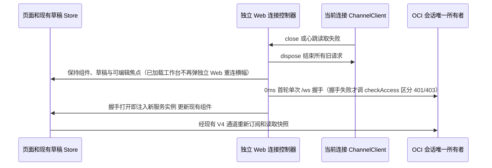
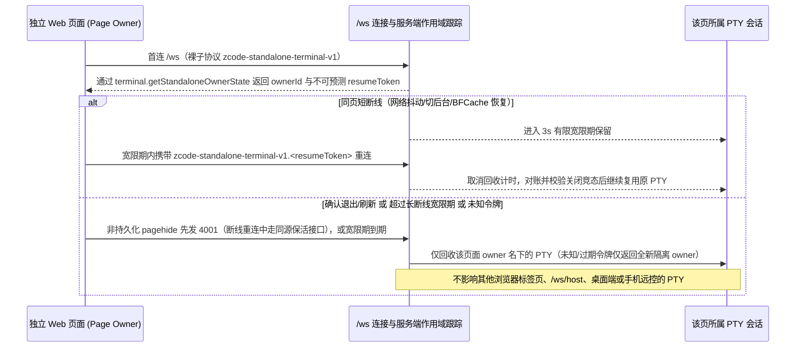

> 本规格描述已直接集成到当前源码的独立 Web 行为。下文的基础版本和补丁顺序仅是历史背景；构建使用本仓库当前源码，不再应用外部覆盖补丁。

# 独立 Web 连接恢复

固定上游 3c5b227649371507ddc4eb46ac5133afe6db1cab。只修复普通 `/ws` 的连接生命周期；桌面 MessagePort 和 `/remote` relay 维持原有所有权和恢复语义。任务管理及桌面能力适配另见交接文档。

## 所有者和事件顺序

- WebSocket 连接适配器拥有自己的 SocketProtocol、ChannelClient、连接截止计时器和 AbortSignal 监听。close、error、abort、握手超时统一幂等清理；旧请求立即失败，关闭后的调用立即失败。
- 页面连接控制器是重试、心跳、当前代际和可用状态的唯一所有者。一次最多一个连接尝试、一条连接、一项心跳读取和一个重试计时器。
- 首屏 `resolveWebBootstrap` 以 `redirect: "manual"` 请求 `/api/server-info`：返回 `200` 且 JSON 时标记 `initialAccessState: "ok"`，首次建连直接跳过重复的访问检查，单次 `/ws` 握手成功即挂载 `<Root>`（不额外等待首包 `system.info` 往返）；`opaqueredirect`、`401`、`403` 标记 `auth-required` 并立即提示重新验证；其余记为 `unknown`，建连前先执行一次 `checkAccess`。
- 已成功连上过（`hadReady`）后的重连同样跳过前置 `checkAccess`，直接发起单次 `/ws` 握手。握手阶段的浏览器 `error` / `close` 由建连失败分支处理，并调用一次 `checkAccess` 区分登录态过期与普通网络或服务断线。已建立连接的 `close` 才直接进入重连。
- 空闲连接每 25 秒经当前 RPC 只读调用 `system.info`，超时 `10000ms`。切回前台时，连接还在就用 `2500ms` 截止时间探活。若空闲探活已在进行，缩短它的剩余等待时间，继续使用同一次 RPC。无应答立即终结旧连接并重连。
- 重试采用 `0ms`、`1s`、`2s`、`4s`、`8s` 的上限退避：首次意外断开或切回前台恢复后的第一次重连延迟为 `0ms`（不额外等待 1 秒），连续失败再按 `1s -> 2s -> 4s -> 8s` 退避；连接成功、手动重试或生命周期恢复事件均将失败计数清零。并发恢复触发不创建多条连接。
- 首连 `3000ms` 内不渲染连接横幅，`#root` 保留 `index.html` 原生居中 Logo 启动动画，握手成功后一次渲染直出工作台首页；首连超过 `3000ms` 仍未就绪才显示连接横幅与手动重试。工作台加载完成后，普通断线重连不再弹出独立 Web 顶部通用重连横幅（打开的会话视图沿用上游会话订阅重连/反馈面板，其“重新连接”按钮仅重试 `lease.store.retry()`，未挂载该面板的设置页或首页不新增额外提示；底层 `/ws` 由连接控制器在后台独立自动重连）。首连或重连遇到 `auth-required` 时立即显示重新验证横幅，点击其中重试可在同一横幅暂态显示“正在连接服务器…”直至连接恢复或再次返回 `auth-required`。
- 断线重连期间复用同一个 React Root、不改变组件 key、不给页面加 `inert`；现有草稿、导航、输入框可编辑态与移动端软键盘保持不变。Zustand 全局 Store 首次捕获的 `broadcastService` 与 `settingService` 使用连接控制器维护的稳定转发引用，其目标随代际切换，不缓存业务事实。
- 新 agent service 实例驱动现有 V4 订阅生命周期重新建立连接；不复用旧连接的 subscriptionId。Host 继续保存任务、命令 admission 和快照，Web 不创建第二个队列。
- 只自动重试握手和只读健康探测，不重放用户消息、Shell、删除、归档或其他写请求。
- Access 认证阻断时保留页面和草稿，立即提供重新验证入口；不泄露或向浏览器下发 ZCode 服务令牌，不修改 Access 或 Caddy。

## 独立 Web 终端（PTY）页面作用域与断线回收

- **复用官方作用域跟踪与服务端签发不可预测令牌**：服务端复用 `createTerminalScope` 隔离终端作用域；仅当同源本地独立 Web 启用 `capabilities.standaloneTerminalOwners`（含 `auth-required` 重试登录后重新读取 `/api/server-info` 确认）时，每个浏览器页面复用单个 `StandaloneTerminalPage` 实例。首连使用裸子协议 `zcode-standalone-terminal-v1`，由服务端在 `terminal.getStandaloneOwnerState()` 返回唯一 `ownerId` 与不可预测 `resumeToken`，重连时携带 `zcode-standalone-terminal-v1.<resumeToken>`；客户端不能自行指定 UUID 认领既有作用域，未知或已过期令牌仅分配全新隔离作用域，不影响任何其他 owner。
- **同源鉴权、传统连接兜底与首屏零阻塞**：带页面子协议的 `/ws` 及同源保活关闭接口 `/api/standalone-terminal-owner/close` 受同源检查与现有单主体令牌鉴权保护；未携带页面子协议的传统 `/ws` 连接（`web-remote-replayable`）按 attachment 局部 `createTerminalScope` 隔离并在断线时回收，不共享宿主全量终端，也不改变 `/ws/host` 与桌面端的原有语义。WS `open` 时立即完成应用首屏挂载（不额外等待 `getStandaloneOwnerState` 往返），终端就绪等待与关闭竞态对账（订阅 `onDynamicData`/`onDynamicExit` 后紧随一次有序快照校验，并结合服务端退出码回放）仅收敛在终端调用范围内。
- **显式退出与长断线精确回收**：非持久化 `pagehide`（非 BFCache）在 `abort` 之前显式关闭终端页面 owner：WS 已打开时直接发送关闭码 `4001` 立即回收；若处于重连/未建连窗口且已持有 `resumeToken`，则发同源保活 `POST /api/standalone-terminal-owner/close`（不可达时回退到 3 秒宽限超时回收）。BFCache 持久化挂起（`event.persisted === true`）不关闭 owner，恢复后沿用同一页面实例重连。

## 验收

1. 断开 WebSocket 后，已发送和新 RPC 均被拒绝，无永久 pending。
2. 无 close 事件的假连接在空闲心跳（10s）或切回前台探活（2.5s）截止后清理并以 `0ms` 立即重连；心跳不会重复堆积。
3. 首屏 `resolveWebBootstrap` 已确认登录态有效时，首连仅一次 `/ws` 握手往返且不清空 `index.html` 启动动画，连上后零横幅直出首页。
4. 服务暂时离线后，按 `0ms -> 1s -> 2s -> 4s -> 8s` 退避恢复 RPC，任务列表和会话读取正常。
5. 迟到的旧代际连接不能覆盖新连接；重复 close 和重复恢复事件不会重复重连。
6. Access 阻断（`401` / `403` / `302`）立即显示重新验证入口，不无限尝试 WebSocket，不丢弃草稿；重新验证继续走现有认证。
7. 断线重连期间不设置 `inert`，浏览器真实页面保留输入草稿与焦点，恢复后可读取最新任务状态；不重复提交任何写命令。
8. 原有独立 Web host alias 补丁仍生效；仅替换 ZCode 镜像，AGM、Access checker、Caddy、Asspp 和游戏服务不变。
9. 独立 Web 终端（PTY）按页面独立 owner 隔离：同页短断线在有限宽限期内重连可保留原 PTY；页面确认关闭/刷新或长断线超时后仅回收该页 PTY，不影响其他标签页、桌面或远控。
