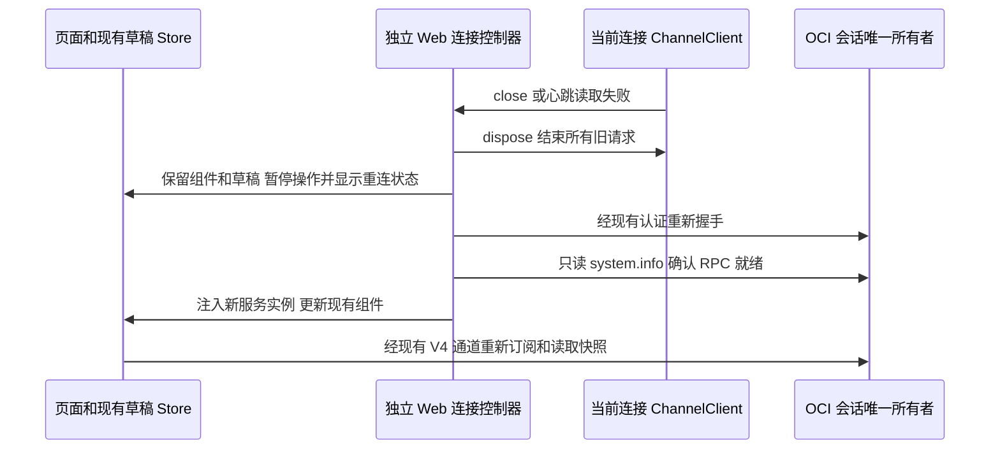

> 本规格描述已直接集成到当前源码的独立 Web 行为。下文的基础版本和补丁顺序仅是历史背景；构建使用本仓库当前源码，不再应用外部覆盖补丁。

# 独立 Web 连接恢复

固定上游 3c5b227649371507ddc4eb46ac5133afe6db1cab。只修复普通 `/ws` 的连接生命周期；桌面 MessagePort 和 `/remote` relay 维持原有所有权和恢复语义。任务管理及桌面能力适配另见交接文档。

## 所有者和事件顺序

- WebSocket 连接适配器拥有自己的 SocketProtocol、ChannelClient、连接截止计时器和 AbortSignal 监听。close、error、abort、握手超时统一幂等清理；旧请求立即失败，关闭后的调用立即失败。
- 页面连接控制器是重试、心跳、当前代际和可用状态的唯一所有者。一次最多一个连接尝试、一条连接、一项心跳读取和一个重试计时器。
- 每 25 秒经当前 RPC 只读调用 `system.info`；10 秒无应答则终结旧连接。重试采用 1、2、4、8 秒的上限退避。online、pageshow、重新可见时立即检查或重试；并发触发不创建多连接。
- 连接就绪需要 WebSocket 打开且 RPC 只读查询成功。旧代际迟到的响应不能发布到新页面。
- reconnect 复用同一个 React Root，不改变组件 key；现有草稿和导航保持。Zustand 全局 Store 首次捕获的 broadcast service 使用连接控制器维护的稳定转发引用，其监听随代际重新绑定，不缓存业务事实。
- 新 agent service 实例驱动现有 V4 订阅生命周期重新建立连接；不复用旧连接的 subscriptionId。Host 继续保存任务、命令 admission 和快照，Web 不创建第二个队列。
- 只自动重试握手和只读健康探测，不重放用户消息、Shell、删除、归档或其他写请求。
- Access 认证阻断时保留页面和草稿，提供重新验证入口；不泄露或向浏览器下发 ZCode 服务令牌，不修改 Access 或 Caddy。

## 验收

1. 断开 WebSocket 后，已发送和新 RPC 均被拒绝，无永久 pending。
2. 无 close 事件的假连接在心跳截止后清理并重连；心跳不会重复堆积。
3. 服务暂时离线后，重试恢复 RPC，任务列表和会话读取正常。
4. 迟到的旧代际连接不能覆盖新连接；重复 close 和重复恢复事件不会重复重连。
5. Access 阻断不无限尝试 WebSocket，不丢弃草稿；重新验证继续走现有认证。
6. 浏览器真实页面保留输入草稿，恢复后可读取最新任务状态；不重复提交任何写命令。
7. 原有独立 Web host alias 补丁仍生效；仅替换 ZCode 镜像，AGM、Access checker、Caddy、Asspp 和游戏服务不变。
