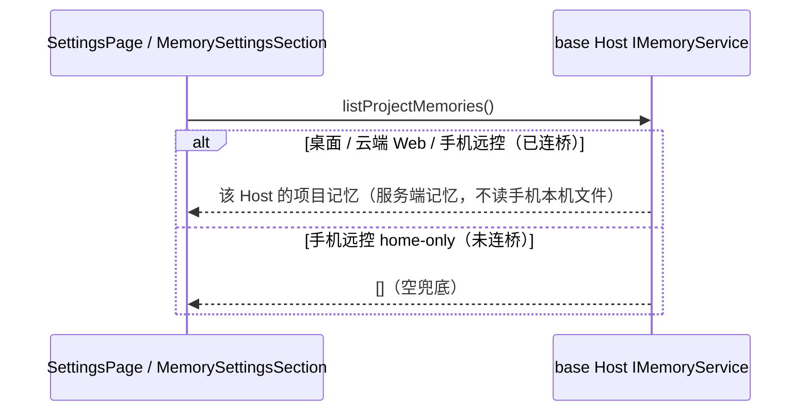
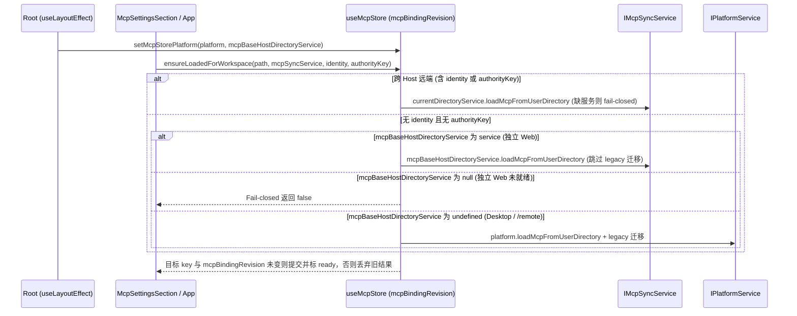

> 本规格描述已直接集成到当前源码的独立 Web 行为。下文的基础版本和补丁顺序仅是历史背景；构建使用本仓库当前源码，不再应用外部覆盖补丁。

# 独立 Web / 手机远控 设置页：服务能力边界与手机布局

固定上游 3c5b227649371507ddc4eb46ac5133afe6db1cab（3.16.2）基础上，本 spec 覆盖设置页两件事：**服务能力边界**（记忆浏览不再按桌面平台假门禁）与**手机单栏布局**。连接生命周期另见 [连接恢复](standalone-web-recovery.md)，任务/项目兼容见 [任务和项目](standalone-web-task-and-project-compat.md)。

不引入能力注册框架，也不新增第二份能力配置。

## 状态所有者与接口

| 事实                                         | 唯一所有者                                                                         | 读取接口                                            |
| -------------------------------------------- | ---------------------------------------------------------------------------------- | --------------------------------------------------- |
| 项目记忆 catalog（按 workspace 的 Markdown） | 所属 Host 数据根 `<dataRoot>/cli/memories/projects` 的 `IMemoryService`            | `SettingsPage` 的 `localHostServices.memoryService` |
| `localHostServices` 的归属                   | 各入口注入的 base Host（桌面本机 Host / 云端 server Host / 手机远控被控桌面 Host） | `useBaseWorkspaceServices()`                        |
| 记忆开关与存储格式                           | 各 base Host 的 `settingService`（`memoryEnabled`）                                | `useSettings({ services: localHostServices })`      |
| 设置页手机导航态                             | `SettingsPage` 局部状态（一个布尔）                                                | `mobileSettingsDetailOpen`                          |

### 记忆浏览：按服务边界判定，不按平台

- `MemorySettingsSection` 的 `projectMemoryViewerAvailable` 不再由 `Boolean(isDesktop)` 决定。base Host 始终提供 `IMemoryService` 契约，桌面、云端 Web、手机远控都通过同一 `localHostServices` 代理读取所属 Host 的项目记忆；旧的 `isDesktop` 门禁把已有服务在 Web 上误判为不可用。
- 不伪造桌面平台，不改 `memoryEnabled` 开关与存储格式，不读手机本机文件；服务读取、禁用开关、错误显示沿用 `MemorySettingsSection` 既有实现。
- 已知边角：手机远控 home-only 未连桥时 catalog 返回空，展示“空”而非“仅本地”。

### 个性化指令：复用官方编辑器

- 独立 Web（电脑与手机）通过 base Host 的 `settingService` 读写服务器 `~/.zcode/AGENTS.md`，复用官方保存/取消、草稿恢复及 100KB 限制；界面说明明确指向当前服务器 Agent。
- 桌面端仍编辑本机用户指令；官方 relay 手机远控仍保留仅桌面端提示。入口边界及验收场景见 [个性化规格](ui/settings-personalization.md)。
- 不新增 API、配置文件或持久化目录，已有用户指令不作迁移或初始化覆盖。

### 浏览器数据：区分三类浏览器

| 概念                | 运行位置                                             | 设置页行为                                   |
| ------------------- | ---------------------------------------------------- | -------------------------------------------- |
| Electron 内置浏览器 | 桌面主进程 `<webview>` guest，`browser-use` 插件驱动 | Chrome 数据导入/清理、忽略证书校验仅桌面可用 |
| Chromium MCP        | 服务端/Agent 运行所在 Host 的无头 Chromium（MCP）    | 不受内置浏览器数据设置限制，Web 上仍可用     |
| Web 页面自身浏览器  | 渲染 Web UI 的手机/电脑浏览器                        | 无控制桥；`openExternal` 仅 `window.open`    |

- `BrowserSettingsSection` 在 `!nativeActionsAvailable` 时按平台区分提示：桌面缺方法用 `settings.browser.desktopOnly`；Web/手机用 `settings.browser.webUnsupported`，明确当前网页无法导入用户电脑 Chrome 数据/清理 Electron 内置浏览器数据，且服务端 Agent 的 Chromium MCP 不受此限制。
- 保留已有 `browser-use` 插件开关与安全区（`isDesktop` 门禁），不新增远程浏览器界面或导入协议。

## 记忆正文：页内查看与最小编辑（本仓新增）

背景（见[问题清单](maintenance/issues.md)）：官方原有“记忆”设置分区仅提供项目记忆文件列表与调用本机外部编辑器（`WorkspaceEditorButtonGroup`），且后端无记忆文件删除接口；独立 Web 下无法调用本机外部编辑器。本仓新增**页内 Markdown 预览 + 最小编辑保存**，不引入完整 IDE，也不新增后端删除接口（如需删除记忆文件交由对话 Agent 处理，尽量少改后端；列表项直接“编辑”菜单暂不实施）。

### 状态所有者与接口

| 事实                                  | 唯一所有者                                                              | 读取/写入接口                                          |
| ------------------------------------- | ----------------------------------------------------------------------- | ------------------------------------------------------ |
| 项目记忆 Markdown 正文                | 所属 Host 数据根 `<dataRoot>/cli/memories/projects` 的 `IMemoryService` | `readProjectMemoryFile` / `saveProjectMemoryFile`      |
| 记忆文件内容版本（mtime + 内容 hash） | `IMemoryService` 稳定读取结果                                           | `readProjectMemoryFile` 返回 `updatedAt`/`contentHash` |
| 编辑草稿、冲突提示、保存中态          | `MemorySettingsViewer` 局部状态                                         | 不写入 store，不持久化                                 |

### 契约

- **复用既有只读底层**：正文读取走 `readProjectMemoryFile`，复用 `projectMemoryStableRead` 的稳定句柄、5 MiB 上限、大小写精确匹配与 `path` 越界校验；在此基础上由本仓新增页内 `MemorySettingsViewer` 预览与编辑界面。
- **本仓新增最小写入** `saveProjectMemoryFile(params)`，`params = { workspaceId, fileName, content, expectedUpdatedAt, expectedContentHash }`：
  - 只允许写已存在的项目记忆 Markdown（`requireExactProjectMemoryFile`），**不新建文件、不提供删除接口、不接受任意路径**，因此不构成通用任意文件写删 API。
  - 写入前用稳定读取重新取当前 `updatedAt` + `contentHash`，与期望值不一致（文件被改动、删除或替换）时抛 `PROJECT_MEMORY_FILE_CHANGED`，**不覆盖**，UI 保留草稿并提示。
  - 写入采用同目录临时文件 + `rename` 的原子替换，正文超限按 `PROJECT_MEMORY_FILE_CHANGED` 同级的写上限错误拒绝。
  - **诚实边界**：检查与 `rename` 之间存在窗口，外部写手仍可能在该窗口替换文件；本实现只保证“读取时刻已变化则拒绝覆盖”，不以锁或超时掩盖这一竞态。
- **不把旧 `saveMemory`（`~/.claude/memory/MEMORY.md` 用户级路径）用于项目记忆**：`saveMemory` 的所有者与路径不同，保持原样。
- **预览/编辑复用既有组件**：正文预览复用 PreviewPane 的 Markdown 渲染（`MarkdownPreviewContent`），编辑使用既有文本框与按钮，不新增富文本或 IDE 依赖；复制路径复用 `useFileContextActions.copyPath`。
- 桌面端不再因 `isDesktop` 差异隐藏页内入口，行为对齐；外部编辑器入口（`WorkspaceEditorButtonGroup`）在 Web 仍不可用，由页内入口取代。

### 验收场景

1. 云端 Web / 桌面：记忆分区点击某文件进入页内查看，渲染 Markdown 正文；顶部提供复制路径、编辑、关闭。
2. 进入编辑修改正文并保存：服务器文件内容更新，列表更新时间刷新；重新打开可见新内容。
3. 读取后文件被外部改写/删除，再保存：提示冲突（`PROJECT_MEMORY_FILE_CHANGED`），**不写入**，编辑框保留草稿；可刷新后重新编辑。
4. 桌面端行为不变，外部编辑器按钮组在该分区不再出现。

## 技能“打开路径”与工作区 `.zcodeignore`“打开文件位置”状态说明

- **技能详情“打开路径”（已撤回适配，待新版部署验证；Web 暂不支持）**：
  - 2026-11-12 实机验证发现，在有活动工作区时点击技能详情路径虽能打开右侧「文件管理」栏，但无法定位到技能目录。
  - **已确认根因**：`SkillsSection` 调用 `useOpenHostDirectory` 时传入当前项目的 `workspacePath` 与外部技能目录 `revealPath`；`WorkspaceFileTree`（286-289 行）在 `revealPath` 不属于当前 `workspacePath` 根目录时直接 `return`，且 `temporaryExternalDirectory` 不会改变文件树根目录。
  - **当前合同**：`SkillsSection` 的技能路径网页适配及无工作区时的 `DirectoryBrowser` 弹窗已撤回适配，待新版部署验证，恢复为原有的 `platform.openInFileManager` + 失败 Toast 提示；独立 Web 下技能打开路径暂不支持（仍弹原有失败提示），技能页“当前服务器” Scope 文案等其余改动保留。
- **工作区文件搜索 `.zcodeignore`“打开文件位置”（单列保留）**：
  - `WorkspaceFileSearchSection` 中点击「打开文件位置」传入的目标路径本身就是当前工作区根目录 `workspacePath`，不存在跨出项目根目录的问题，因此继续保留 `useOpenHostDirectory` 打开右侧「文件管理」面板，未随技能路径一同回退。

## 插件来源：服务端目录选择

历史症状：`AddMarketplaceSourceDialog` 在独立 Web 隐藏“选择目录”，无法添加服务端本地目录来源。

- 桌面端保持原生 `platform.selectDirectory` 与拖放（拖放解析的是受控端本机路径）。
- 独立 Web：复用既有 `DirectoryBrowser`（服务端 `fileService.readdir` 浏览），在对话框内嵌选择服务端目录，选中的服务端绝对路径写回来源输入框。**浏览器所在电脑路径不作为 server 路径**。
- 不新增后端接口；`DirectoryBrowser` 优先使用 `PluginStorePage` 传入的与 `addMarketplace` 同源的 `services`（缺省回退 `localHostServices`）。

### 验收场景

1. 独立 Web：点击“选择目录”在对话框内浏览服务端目录，确认后来源输入框填充服务端路径，可继续添加。
2. 桌面端：“选择目录”仍打开系统目录选择框。

## 设置页 Scope 文案：当前服务器 / 当前项目

- 独立 Web（含手机远控）下当前服务器承载的 `local` 设备 `user` 作用域指向**当前服务器 Host**：文案统一为“当前服务器”，不写死服务器地址或凭据，不使用浏览器本机语义；远端（`remote`）设备分组仍显示其设备名与“用户”标签。
- project 作用域仍指**当前项目**，判定与数据不改。
- 四类资源（技能 / 子代理 / MCP / 指令）的 scope 归属保持一致：user/local → 当前服务器，project → 当前项目；不伪造平台、不改 scope 数据。

### 验收场景

1. 独立 Web：设置页技能、子代理、MCP 的 user/local 选项文案显示“当前服务器”，project 显示“当前项目”。
2. 桌面端：文案与作用域行为不变。

## MCP 配置读写与目标服务归属

历史症状：`useMcpStore` 曾将 `!currentWorkspaceIdentity && !currentAuthorityKey` 当作桌面本机探测并返回 `null`，导致独立 Web 丢弃已绑定服务、回退到无桌面代理的 Web `platform` 读取硬编码空列表 `{ servers: [] }` 并误标 ready（表现为顶栏计入插件 MCP，但“已安装”用户级 MCP 为 0）。

### 状态所有者与接口

| 事实                   | 唯一所有者                                                                                                                                 | 接口与约束                                                                                                                                                                                                                                                           |
| ---------------------- | ------------------------------------------------------------------------------------------------------------------------------------------ | -------------------------------------------------------------------------------------------------------------------------------------------------------------------------------------------------------------------------------------------------------------------- |
| Base Host 目录归属三态 | 入口 `packages/web/src/main.tsx` → `Root`（`useLayoutEffect`）→ `setMcpStorePlatform`                                                      | `mcpBaseHostDirectoryService`：默认 `undefined`（Desktop / `/remote` 走 `platform`）；`null`（独立 Web base-required 未就绪或卸载清理间隙，fail-closed）；`service`（独立 Web 已绑定 `services.mcpSyncService`）                                                     |
| 目标绑定与代际版本     | `useMcpStore` 四元组 `(currentProjectPath, currentWorkspaceIdentity, currentAuthorityKey, currentDirectoryService)` + `mcpBindingRevision` | 目标 key 变化、远端目标换服务对象或 `setMcpStorePlatform` 更换 base Host / pending 状态均递增 `mcpBindingRevision` 使在途旧读取失效（无 identity/authority 下两处 wrapper 仍指向同一 base Host 时不误取消）；独立 Web 下手动 `migrateLegacyCommonMcp` 同样保持 no-op |
| Store 投影与就绪门禁   | `useMcpStore` 与 `McpSettingsSection`（`mcpConfigReadyWorkspaceKey`）                                                                      | 仅当目标 key 与 `mcpBindingRevision` 未变且读取成功时才提交 store 并标记 ready；读取失败保持 not-ready                                                                                                                                                               |
| Host 磁盘配置与运行态  | 目标所属 Host 的 `IMcpSyncService`（或桌面本机 `IPlatformService`）                                                                        | 复用既有 `loadMcpFromUserDirectory`、`saveMcpToUserDirectory`、`listWorkspaceMcpServerStatuses`；不新增后端 API                                                                                                                                                      |

### 四类目标环境矩阵

`workspaceIdentity` 仅用于工作区身份隔离，`workspacePath` 用于文件操作、命令 `cwd`、Git 与路径展示；无 `workspaceIdentity` 的入口归属由 `mcpBaseHostDirectoryService` 决定，不伪造 `workspaceIdentity`：

| 目标场景                                          | `workspaceIdentity` / `authorityKey` | `mcpBaseHostDirectoryService` | 目标目录通道                                                                  | Legacy Common 迁移                             | 缺服务行为                                          |
| ------------------------------------------------- | ------------------------------------ | ----------------------------- | ----------------------------------------------------------------------------- | ---------------------------------------------- | --------------------------------------------------- |
| 独立 Web base server Host（当前服务器与项目）     | 均为空                               | `service`（未就绪为 `null`）  | 使用 `mcpBaseHostDirectoryService` 读取（会话/设置）与写入（增删改/启停）     | 跳过（浏览器旧 `localStorage` 不写云端也不删） | `null` 时 fail-closed 报错，不回退 Web `platform`   |
| Desktop 本机（本机用户与本机项目）                | 均为空                               | `undefined`                   | 返回 `null`，走 Desktop `IPlatformService`                                    | 执行（保留本机旧 `common` 迁移）               | `platform` 失败返回 `false`                         |
| 官方手机 relay `/remote`（被控桌面）              | 均为空                               | `undefined`                   | 返回 `null`，经 `platformProxy` 转发被控桌面；Plain Web 无代理走空/不支持兜底 | 随 `platformProxy` 既有契约                    | 未连桥/断连按既有门禁处理                           |
| 跨 Host 远端（SSH / Docker / WSL 项目与远端用户） | 存在其一或全部                       | 任意                          | 使用目标绑定的 `currentDirectoryService`                                      | 跳过                                           | Fail-closed：缺服务直接抛错，不回退本机或 base Host |

### 验收场景

1. 独立 Web：进入设置页 MCP 选择“当前服务器”或服务器项目，用户级与项目级 MCP 在“已安装”分组正常展示并刷新连接状态；会话 `ensureLoadedForWorkspace` 读取同一目标配置。
2. 独立 Web：新增、编辑、删除、启停 MCP 经当前服务器 `mcpSyncService` 持久化，刷新后保持；浏览器旧 `localStorage` common MCP 不写入服务器也不被删除。
3. 首次加载与重连换绑：首屏不因 passive effect 早于注入而读到假空；重连更换服务实例或快速切换目标时，在途旧读取被 `mcpBindingRevision` 丢弃。
4. Desktop、`/remote` 与跨 Host 远端：Desktop 本机读写与 legacy 迁移、手机 `/remote` 代理、跨 Host 远端读写及缺服务 fail-closed 行为不变。

## 手机设置页单栏布局

- 生效条件：`!isDesktop && useIsMobileCompactViewport()`（`max-width: 767px`）。宽屏桌面与窄窗口桌面保持原双栏。
- 根容器标记 `data-mobile-settings`；单栏下列表与详情互斥显示，不再保留桌面 68px 图标栏。
- 列表态：复用现有导航按钮，列表项显示图标 + 完整文字（不折叠成图标栏），触控高度 ≥44px；保留返回工作区入口。
- 详情态：保留设置标题与可触控返回按钮（回到列表）；其余设置内容与桌面一致。
- 不复制设置业务状态，仅新增一个导航布尔；使用现有 `useIsMobileCompactViewport` 与设计 token，不修改 html 字体缩放。

## 验收场景

1. 桌面端：设置页仍为左侧导航 + 内容双栏，导航项在窄窗口保持图标栏；记忆浏览与浏览器数据行为不变。
2. 云端 Web / 手机远控（已连桥）：记忆设置可浏览**服务端/被控端**项目记忆，不读手机本机文件；`memoryEnabled` 开关与存储格式不变。
3. 手机（≤767px，非桌面）：设置页进入列表页（图标 + 完整文字，触控 ≥44px）；点击某分区进入单栏详情；详情返回按钮回到列表。
4. Web 设置页“浏览器数据”提示为 `settings.browser.webUnsupported`，说明 Chromium MCP 不受限；桌面端提示不变，Chrome 数据导入/清理按钮在 Web 仍禁用。
