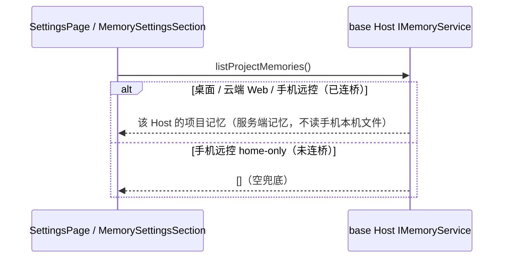

> 本规格描述已直接集成到当前源码的独立 Web 行为。下文的基础版本和补丁顺序仅是历史背景；构建使用本仓库当前源码，不再应用外部覆盖补丁。

# 独立 Web / 手机远控 设置页：服务能力边界与手机布局

固定上游 3c5b227649371507ddc4eb46ac5133afe6db1cab（3.16.2）基础上，本 spec 覆盖设置页两件事：**服务能力边界**（记忆浏览不再按桌面平台假门禁）与**手机单栏布局**。连接生命周期另见 [连接恢复](standalone-web-recovery.md)，任务/项目兼容见 [任务和项目](standalone-web-task-and-project-compat.md)。

不引入能力注册框架，也不新增第二份能力配置。

## 状态所有者与接口

| 事实 | 唯一所有者 | 读取接口 |
| --- | --- | --- |
| 项目记忆 catalog（按 workspace 的 Markdown） | 所属 Host 数据根 `<dataRoot>/cli/memories/projects` 的 `IMemoryService` | `SettingsPage` 的 `localHostServices.memoryService` |
| `localHostServices` 的归属 | 各入口注入的 base Host（桌面本机 Host / 云端 server Host / 手机远控被控桌面 Host） | `useBaseWorkspaceServices()` |
| 记忆开关与存储格式 | 各 base Host 的 `settingService`（`memoryEnabled`） | `useSettings({ services: localHostServices })` |
| 设置页手机导航态 | `SettingsPage` 局部状态（一个布尔） | `mobileSettingsDetailOpen` |

### 记忆浏览：按服务边界判定，不按平台

- `MemorySettingsSection` 的 `projectMemoryViewerAvailable` 不再由 `Boolean(isDesktop)` 决定。base Host 始终提供 `IMemoryService` 契约，桌面、云端 Web、手机远控都通过同一 `localHostServices` 代理读取所属 Host 的项目记忆；旧的 `isDesktop` 门禁把已有服务在 Web 上误判为不可用。
- 不伪造桌面平台，不改 `memoryEnabled` 开关与存储格式，不读手机本机文件；服务读取、禁用开关、错误显示沿用 `MemorySettingsSection` 既有实现。
- 已知边角：手机远控 home-only 未连桥时 catalog 返回空，展示“空”而非“仅本地”。

### 浏览器数据：区分三类浏览器

| 概念 | 运行位置 | 设置页行为 |
| --- | --- | --- |
| Electron 内置浏览器 | 桌面主进程 `<webview>` guest，`browser-use` 插件驱动 | Chrome 数据导入/清理、忽略证书校验仅桌面可用 |
| Chromium MCP | 服务端/Agent 运行所在 Host 的无头 Chromium（MCP） | 不受内置浏览器数据设置限制，Web 上仍可用 |
| Web 页面自身浏览器 | 渲染 Web UI 的手机/电脑浏览器 | 无控制桥；`openExternal` 仅 `window.open` |

- `BrowserSettingsSection` 在 `!nativeActionsAvailable` 时按平台区分提示：桌面缺方法用 `settings.browser.desktopOnly`；Web/手机用 `settings.browser.webUnsupported`，明确当前网页无法导入用户电脑 Chrome 数据/清理 Electron 内置浏览器数据，且服务端 Agent 的 Chromium MCP 不受此限制。
- 保留已有 `browser-use` 插件开关与安全区（`isDesktop` 门禁），不新增远程浏览器界面或导入协议。

## 手机设置页单栏布局

- 生效条件：`!isDesktop && useIsMobileCompactViewport()`（`max-width: 767px`）。宽屏桌面与窄窗口桌面保持原双栏。
- 根容器标记 `data-mobile-settings`；单栏下列表与详情互斥显示，不再保留桌面 68px 图标栏。
- 列表态：复用现有导航按钮，列表项显示图标 + 完整文字（不折叠成图标栏），触控高度 ≥44px；保留返回工作区入口。
- 详情态：保留设置标题与可触控返回按钮（回到列表）；其余设置内容与桌面一致。
- 不复制设置业务状态，仅新增一个导航布尔；使用现有 `useIsMobileCompactViewport` 与设计 token，不修改 html 字体缩放。

## 验收场景

1. 桌面端：设置页仍为左侧导航 + 内容双栏，导航项在窄窗口保持图标栏；记忆浏览与浏览器数据行为不变。
2. 云端 Web / 手机远控（已连桥）：记忆设置可浏览**服务端/被控端**项目记忆，不读手机本机文件；`memoryEnabled` 开关与存储格式不变。
3. 手机（≤767px，非桌面）：设置页进入列表页（图标 + 完整文字，触控 ≥44px）；点击某分区进入单栏详情；详情返回按钮回到列表。
4. Web 设置页“浏览器数据”提示为 `settings.browser.webUnsupported`，说明 Chromium MCP 不受限；桌面端提示不变，Chrome 数据导入/清理按钮在 Web 仍禁用。
