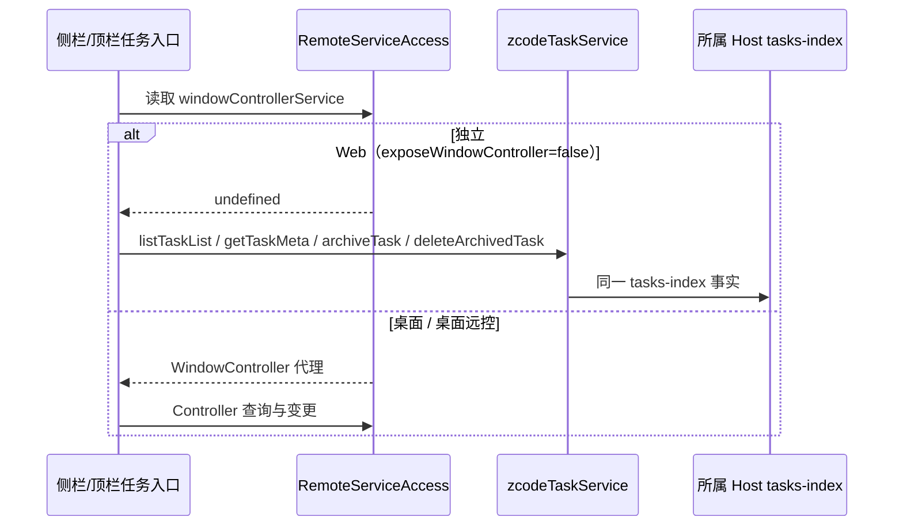
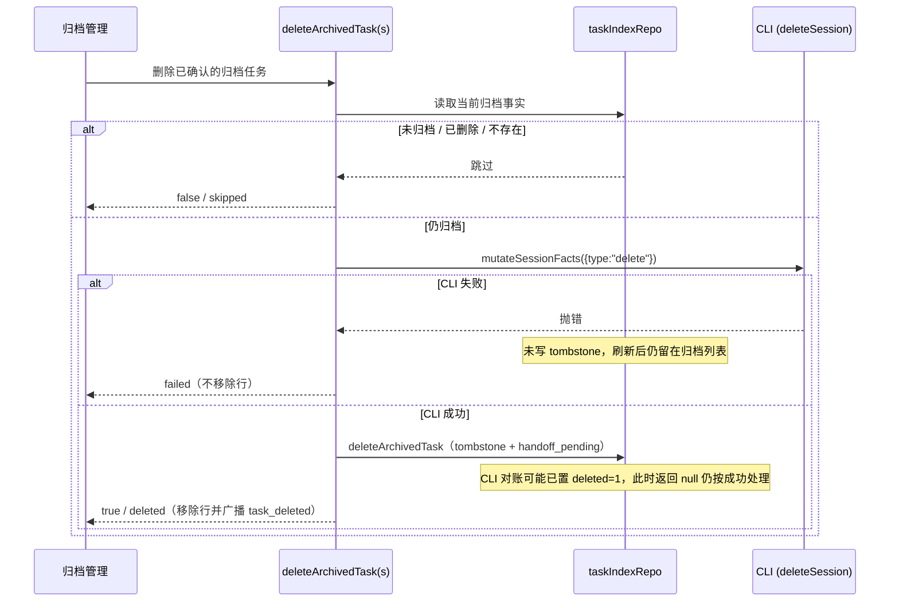
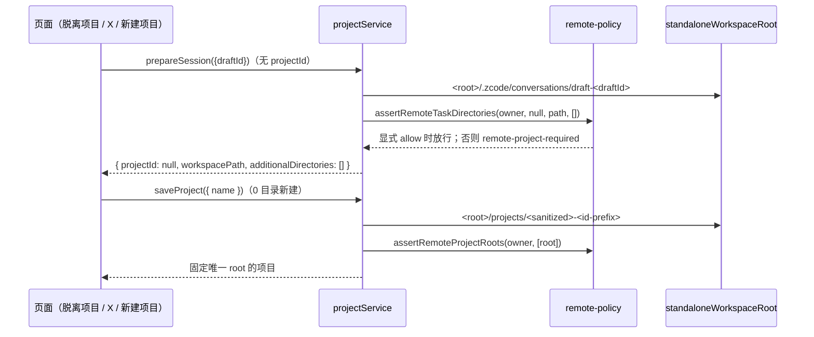

# 独立 Web 任务管理与非项目工作模式

固定上游 3c5b227649371507ddc4eb46ac5133afe6db1cab（3.16.2）。本 spec 覆盖两件事：**第一项**独立 Web 的任务归档/取消归档/删除/重命名/置顶/已读状态与列表订阅回退；**补充项**项目创建（0 目录/1 目录/多目录）与非项目工作模式。连接生命周期另见 `docs/standalone-web-recovery.md`。

兼容入口只限定在显式的独立云端配置（`allowStandaloneCloudWorkspaces` 由 `ZCODE_STANDALONE_WEB_LOCAL_HOST_ALIAS === "1"` 打开）。桌面 MessagePort、桌面远控 `/remote` relay、真实远端 Source 的契约不变。

## 状态所有者与接口

| 事实 | 唯一所有者 | 写入接口 |
| --- | --- | --- |
| 任务组织态（archived / pinned / unread / title） | 所属 Host 的 tasks-index（`taskIndexRepo`） | `zcodeTaskService`（独立 Web）/ `windowControllerService`（桌面） |
| CLI 会话删除事实 | CLI（经 `zcodeTaskIndexSyncer` → `deleteSession`） | `taskIndexSyncer.mutateSessionFacts({type:"delete"})` |
| 归档条件删除裁决 | `zcodeTaskServiceAdapter.deleteArchivedTask(s)` | 先读归档事实，再 CLI，最后 tombstone |
| 项目 root 与归属 | 所属 Host 的 project 库 | `projectService.saveProject` / `prepareSession` |
| 非项目草稿目录 | 服务端按 `draftId` 分配 | `projectService.prepareSession({draftId})` |

### 第一项：服务暴露与回退

- `RemoteServiceAccess` 只在 `exposeWindowController !== false` 时构造 `windowControllerService`。`connectViaWebSocket`（普通 Web）默认传 `false`；`connectViaMessagePort`（桌面）与 `connectViaProtocol`（`/remote` relay）保持构造，不改成可选。
- 独立 Web 下 `useGlobalTaskList` 不再因缺失 Controller 直接报错返回：`refresh` 改用 `zcodeTaskService.listTaskList(query)`，并保留请求序号防竞态、排序与 `onSnapshotLoaded`；`useEffect` 在缺 Controller 时同时订阅 `refreshEventName` 与每个 `workspaceScopes` 的 `zcodeTaskService.onDynamicWorkspaceEvent(scope)`，保证顶栏置顶状态与全局搜索刷新。
- 任务 mutation 复用既有 `task-mutation` 回退：`readProjectTaskMeta` / `mutateProjectTask` 在无 Controller 时走 `zcodeTaskService`（归档、取消归档、重命名、置顶、已读/未读）。
- 归档管理删除复用带归档条件检查的 `deleteArchivedTask`，不把普通 `deleteTask` 当作归档删除。

### 第一项：删除的顺序保障（失败项不提前隐藏）

- `taskIndexRepo.deleteArchivedTask` 是唯一写 tombstone（`deleted=1` + `handoff_pending |= 1`）的入口，且与归档检查同事务；`getTaskMeta` 不返回 `archived`，故新增只读 `getTaskIndexFlags` 暴露 `archived/deleted` 事实供前置裁决，不返回完整 meta。
- 顺序固定为「读归档事实 → CLI 删除 → tombstone」。CLI 成功但 tombstone 返回 `null`（CLI 对账已把该行置 `deleted=1`）时视为删除成功并广播，避免刷新/重连复活。
- 批次 `deleteArchivedTasks` 采用同一顺序：未归档计入 `skippedTaskIds`；CLI 抛错计入 `failedTaskIds` 且不写 tombstone；全部成功后只广播一次。
- 归档管理把单条结果映射为 `deleted → succeeded + 移除行`、`skipped → skipped + 移除行`、`异常 → failed + 不移除行`。

### 补充项：非项目工作模式与项目 root

- `assertRemoteTaskDirectories` 增加可选策略：仅当 `allowStandaloneNonProject` 为真、`additionalDirectories` 为空、`workspacePath` 非空且位于 `standaloneWorkspaceRoot` 之内时放行无项目会话；否则维持 `project.remote-project-required`。跨 Host 与 canonical owner 不变。
- `ProjectRepository` / `createProjectService` 透传 `allowStandaloneCloudWorkspaces` 与 `standaloneWorkspaceRoot`；`node.ts` 仅在 standalone server 且 `ZCODE_STANDALONE_WEB_LOCAL_HOST_ALIAS === "1"` 时开启，root 取 `ZCODE_DEFAULT_WORKSPACE_DIR || /workspace`。
- `prepareSession` 无 `projectId`：普通本地模式仍用原 `workspaceDirectory`；独立云端开启时用 `<root>/.zcode/conversations`，按 `draftId` 分配稳定目录（相同 `draftId` 幂等复用）。remote owner 未开启策略时仍抛 `project.remote-project-required`。
- `saveProject` 0 目录新建项目：remote owner 且开启策略时在 `<root>/projects` 下自动创建专用目录并固定为唯一 root（相同项目 ID 重试复用同一 root）；1 个目录正常保存；>1 个目录抛 `project.remote-single-root-required`；改动既有 root 抛 `project.remote-root-immutable`。
- 前端：非项目草稿绑定稳定 `draftId`，切换时显式 `projectId: null` 并保留转移中的草稿；`ProjectEditor` 单 root 模式下选择目录最多保留 1 个、既有项目 root 固定不可移除，独立云端新建项目允许 0 目录并给出说明文案；`formatProjectError` 为三个错误码提供可读国际化文案，不向用户暴露原始错误码。

## 验收场景

**Area A**

1. `exposeWindowController:false` 时 `windowControllerService` 为 `undefined`；默认 / MessagePort / Protocol 下保留。
2. 无 Controller 时 `readProjectTaskMeta` / `mutateProjectTask` 走 `zcodeTaskService`：归档、取消归档、重命名、置顶、已读、未读各自命中对应方法。
3. 归档条件删除：已取消归档 → `false` / `skippedTaskIds`；CLI 抛错 → `failedTaskIds` 且 repo 未被写成 `deleted=1`；CLI 成功 → 删除完成且刷新/重连不复活。
4. 归档管理计数：成功 `succeeded`、跳过 `skipped`（移除行）、失败 `failed`（不移除行）。
5. 列表归档、菜单归档、设置取消归档在刷新与新连接后状态一致；重命名、置顶、已读状态及列表刷新正常。

**Area B**

6. 开启策略时无 `projectId` 的 `prepareSession({draftId})` 在 `<root>/.zcode/conversations` 下分配稳定目录，相同 `draftId` 幂等复用；`reserveCreatedTask` / `resolveDirectories` 允许 `projectId:null` 且 `additionalDirectories:[]`。
7. 0 目录新建项目自动分配并固定唯一 root（相同项目 ID 重试幂等）；1 目录成功；>1 目录抛 `project.remote-single-root-required`；改既有 root 抛 `project.remote-root-immutable`。
8. 未开启策略的普通远端 owner 仍抛 `project.remote-project-required` 与 `project.remote-single-root-required`；跨 Host 仍被拒绝。
9. 既有独立 Web host alias 与连接恢复补丁仍生效；仅替换 ZCode 镜像，AGM、Access checker、Caddy 与其他服务不变。
